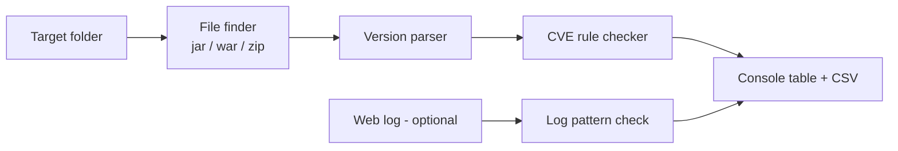
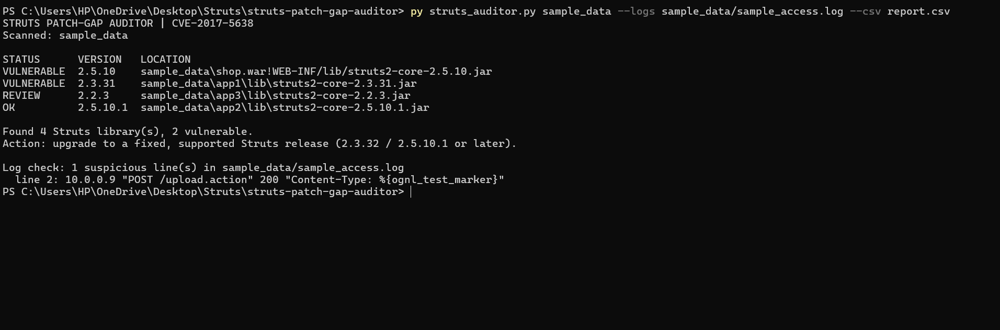
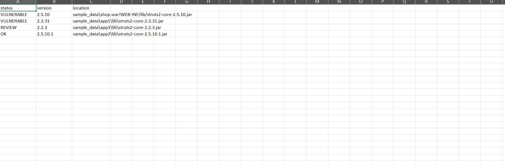
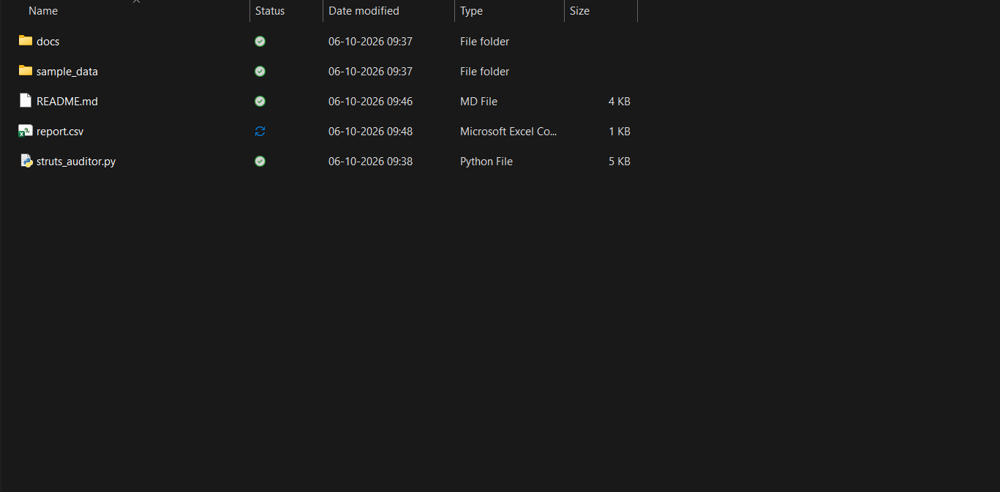

# Struts Patch-Gap Auditor

A small Python tool that finds Apache Struts 2 libraries on a system and flags versions vulnerable to **CVE-2017-5638**, the flaw exploited in the **2017 Equifax data breach**.

> Defensive use only. The tool contains no exploit code.

## Equifax case summary
- Attackers entered through Equifax's online dispute portal, which ran a vulnerable Apache Struts version, and stayed inside for about 76 days (GAO-18-559).
- The Struts fix was public on 7 March 2017. Equifax's internal alert and scan did not lead to the system being patched.
- About 145 million people were affected; around 9,000 queries touched 51 databases.
- The root problem this tool addresses: **the organisation did not know where vulnerable Struts was running.**

## The vulnerability
CVE-2017-5638 (advisory S2-045) is a remote code execution flaw (CVSS 10.0) in the Struts Jakarta Multipart parser. A crafted `Content-Type` header was evaluated as an OGNL expression, letting an unauthenticated attacker run code on the server.
Affected: Struts 2.3.5 to 2.3.31 and 2.5.0 to 2.5.10. Fixed in 2.3.32 and 2.5.10.1.

## Defensive approach
1. **Inventory:** find every `struts2-core-*.jar`, including inside `.war`/`.zip` files.
2. **Check:** compare each version with the CVE-2017-5638 ranges.
3. **Report:** show VULNERABLE / REVIEW / OK and exit with code 1 if anything is vulnerable (useful in CI or scheduled checks).
4. **Detect (optional):** flag log lines where a `Content-Type` header contains `%{`, `${` or `ognl`.

## Architecture


## Installation and usage
Requires Python 3.8+. No third-party packages.
```bash
git clone https://github.com/Piyush-Tiwatne/struts-patch-gap-auditor.git
cd struts-patch-gap-auditor
python struts_auditor.py sample_data --logs sample_data/sample_access.log --csv report.csv
```

## Sample output
```
STRUTS PATCH-GAP AUDITOR | CVE-2017-5638
Scanned: sample_data 

STATUS      VERSION   LOCATION
VULNERABLE  2.5.10    sample_data/shop.war!WEB-INF/lib/struts2-core-2.5.10.jar
VULNERABLE  2.3.31    sample_data/app1/lib/struts2-core-2.3.31.jar
REVIEW      2.2.3     sample_data/app3/lib/struts2-core-2.2.3.jar
OK          2.5.10.1  sample_data/app2/lib/struts2-core-2.5.10.1.jar

Found 4 Struts library(s), 2 vulnerable.
Action: upgrade to a fixed, supported Struts release (2.3.32 / 2.5.10.1 or later).

Log check: 1 suspicious line(s) in sample_data/sample_access.log
  line 2: 10.0.0.9 "POST /upload.action" 200 "Content-Type: %{ognl_test_marker}"
```




## Test results
Run on the included `sample_data`: 4 libraries found, 2 vulnerable (2.3.31 and 2.5.10, the latter inside a .war), 1 old version flagged for review, 1 fixed version (2.5.10.1) marked OK, and 1 suspicious log line detected.

## Limitations
- Detects Struts by file name; renamed or repackaged ("fat") jars are missed.
- Only checks CVE-2017-5638. OK means "not vulnerable to this CVE", not "secure".
- Log check only works if the server logs the Content-Type header, and uses simple patterns.
- Not a replacement for full software-composition scanners.

## Future improvements
More CVEs (for example CVE-2018-11776), jar-manifest version detection, nested archives, NVD lookups, HTML reports, scheduled scans.

## References
- U.S. GAO, *Data Protection: Actions Taken by Equifax and Federal Agencies*, GAO-18-559 (2018)
- U.S. House Oversight Committee, *The Equifax Data Breach* (2018)
- U.S. Senate PSI, *How Equifax Neglected Cybersecurity* (2019)
- FTC press release on the Equifax settlement (2019)
- NVD entry for CVE-2017-5638; Apache Struts advisory S2-045
